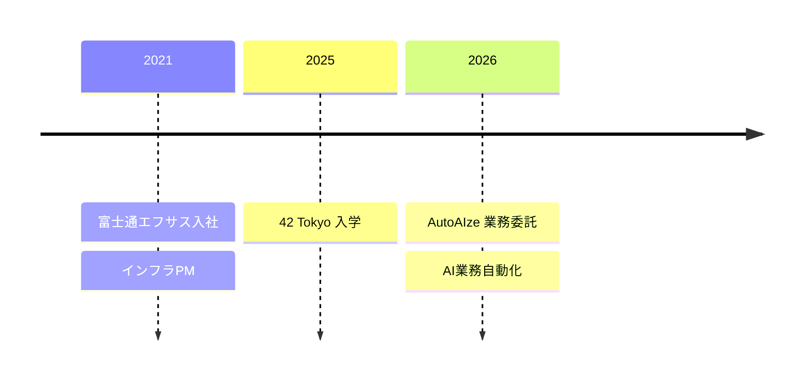

## 👤 経歴

## 🛠 Skills

## 📜 資格
- CCNA（Cisco Certified Network Associate）
- AWS Certified Cloud Practitioner
- Microsoft Certified: Azure Fundamentals（AZ-900）

## 🏫 42 Tokyo Projects
| Milestone | Project | 内容 | 言語 |
|---|---|---|---|
| 0 | Libft | C標準ライブラリ関数の再実装 | C |
| 1 | ft_printf | printf の再実装 | C |
| 1 | get_next_line | ファイルを1行ずつ読む関数 | C |
| 1 | Born2beroot | 仮想マシンでLinuxサーバー構築 | Linux |
| 2 | push_swap | 2つのスタックを使ったソート | C |
| 2 | A-Maze-ing | 迷路の生成 | Python |
| 2 | Python Module 00–10 | Python基礎モジュール | Python |
| 3 | Fly-in | ドローンを最少ターンで届けるシミュレータ | Python |
| 3 | [Call Me Maybe](https://github.com/kamurai42tokyo/Call_Me_Maybe) | LLMの関数呼び出し（constrained decoding） | Python |
| 3 | [Codexion](https://github.com/kamurai42tokyo/Codexion) | マルチスレッドの資源競合シミュレータ | C |

## 🌐 AppLab
自作アプリの起動ハブ 👉 **[Kamurai's AppLab](https://kamurai42tokyo.github.io)**

